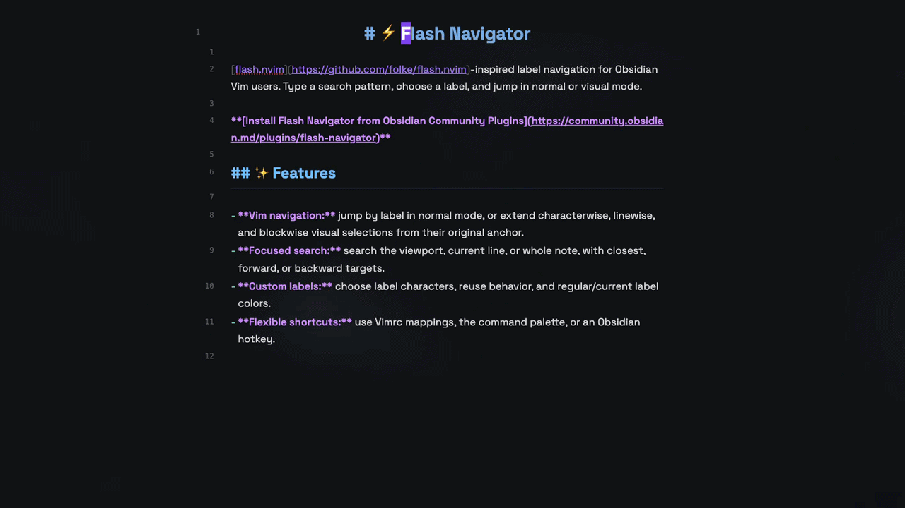

# ⚡ Flash Navigator

[flash.nvim](https://github.com/folke/flash.nvim)-inspired label navigation for Obsidian Vim users. Type a search pattern, choose a label, and jump in normal or visual mode.

**[Install Flash Navigator from Obsidian Community Plugins](https://community.obsidian.md/plugins/flash-navigator)**



## ✨ Features

- **Vim navigation:** jump by label in normal mode, or extend characterwise, linewise, and blockwise visual selections from their original anchor.
- **Focused search:** search the viewport, current line, or whole note, with closest, forward, or backward targets.
- **Custom labels:** choose label characters, reuse behavior, and regular/current label colors.
- **Flexible shortcuts:** use Vimrc mappings, the command palette, or an Obsidian hotkey.

## Install and set up Vim

1. Open **Settings → Community plugins**, find **Flash Navigator**, install it, and enable it.
2. Turn on **Vim key bindings** in **Settings → Editor**.
3. Install and enable [Vimrc Support](https://github.com/esm7/obsidian-vimrc-support) from Community plugins.
4. Add these mappings to `.obsidian.vimrc` in your vault root, alongside any existing configuration:

```vim
exmap flash obcommand flash-navigator:flash-nav-start
nmap s :flash<CR>
vmap s :flash<CR>
```

5. Restart Obsidian or reload Vimrc Support to load the mappings.

These mappings override Vim's usual `s` substitute behavior. To choose another key, replace `s` on the left of both mappings. For example, use F6 instead:

```vim
nmap <F6> :flash<CR>
vmap <F6> :flash<CR>
```

Keep the `exmap flash` line and `<CR>` endings. Choose a key that does not conflict with your other Vim mappings or Obsidian hotkeys, then reload the configuration.

## 🎯 Jump with labels

1. Press `s` in normal or visual mode.
2. Type a search pattern to reveal matching targets and labels.
3. Press a label to jump. In visual mode, the jump extends your selection from its anchor, preserving characterwise, linewise, or blockwise mode.

| Key | Action |
| --- | --- |
| Target label | Jump to that match |
| Enter | Jump to the current target |
| Backspace | Edit the search pattern |
| Esc | Cancel Flash |

You can also run **Flash Navigator: Start jump** from the command palette or assign it an Obsidian hotkey under **Settings → Hotkeys**. This works without Vimrc Support.

## ⚙️ Settings

Open **Settings → Flash Navigator** to configure the plugin. Defaults are shown below.

| Setting | Default | What it controls |
| --- | --- | --- |
| Search scope | Viewport | Search the viewport, current line, or whole note. |
| Search direction | Closest | Choose closest targets or limit matches to forward/backward of the cursor. |
| Case sensitive | Off | Match the exact letter case of the search pattern. |
| Smart case | On | A–Z in the pattern enables exact-case matching when Case sensitive is off. |
| Label alphabet | `asdfghjklqwertyuiopzxcvbnm` | Assign label characters in this order. |
| Label reuse mode | Lowercase | Reuse labels while refining a search: None, Lowercase, or All. |
| Label current match | On | Show a label on the primary match. Enter can always jump to it. |
| Label color | `#3b82f6` | Background color for regular jump labels. |
| Current label color | `#ef4444` | Background color for the current label, selected with Enter. |
| Auto jump single match | Off | Jump automatically when only one match remains. |
| Backdrop dim opacity | 52% | Dim non-matching text while Flash is active; adjustable from 0–90%. |

The color **Reset** buttons use your current Obsidian accent color.

## Feedback and development

[Report a bug](https://github.com/iyioon/obsidian-flash-nav/issues/new?template=bug_report.md) with your Obsidian version, editor mode, Vim mappings, and steps to reproduce.

For development setup and checks, see [Development](docs/DEVELOPMENT.md). See also [Contributing](CONTRIBUTING.md) and the [release process](docs/RELEASING.md).

Released under the [MIT License](LICENSE).
